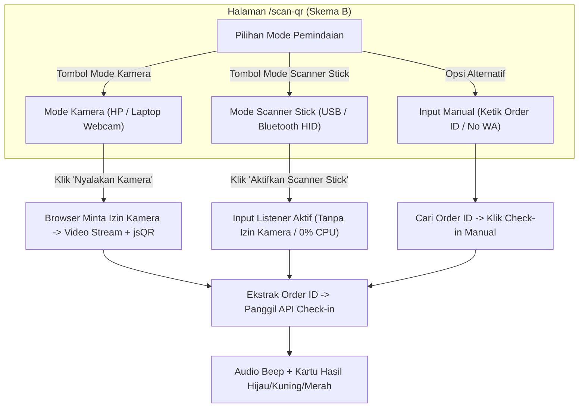

# ARSITEKTUR & PANDUAN INTEGRASI SCANNER QR HARDWARE
## dvflow: Integrasi Kamera Laptop, USB Webcam, dan Barcode Scanner Gun (USB / Bluetooth)

Dokumen Versi: 2.0  
Topik: Solusi Teknis Pemindaian QR Tiket di Lapangan

---

## 1. Analisis Kebutuhan: Apakah Menggunakan Scanner Eksternal Itu Ribet?

> **Jawaban Singkat:**
> **SAMA SEKALI TIDAK RIBET.** Justru pemakaian **Barcode Scanner Gun fisik (USB / Bluetooth)** adalah metode yang **paling direkomendasikan, paling stabil, dan paling cepat** untuk meja registrasi acara berkapasitas besar.

Ada 2 jenis perangkat scanner yang biasa digunakan di lapangan:
1. **Model A: Kamera Video Eksternal (USB Webcam / Document Camera)**.
2. **Model B: Barcode / 2D QR Scanner Gun Fisik (Kabel USB atau Wireless Bluetooth / 2.4G Dongle)**.

Keduanya memiliki mekanisme kerja yang berbeda di browser, dan sistem **dvflow** dirancang untuk mendukung **keduanya secara bersamaan (*Dual-Mode*)**.

---

## 2. Model A: Kamera Video (Webcam Bawaan Laptop & USB Webcam)

### Cara Kerja
- Menggunakan standar HTML5 `navigator.mediaDevices.getUserMedia({ video: ... })`.
- Begitu halaman `/scan-qr` dibuka, browser akan menampilkan pop-up standar satu kali:  
  *"`dvflow.pages.dev wants to use your camera -> [Allow] [Block]`"*.
- Jika diizinkan (*Allow*), browser langsung mengalirkan video (*video stream*) ke elemen `<video>`, dan pustaka `jsQR` di aplikasi membaca frame demi frame (~7 kali per detik).

### Jika Menggunakan USB Webcam Tambahan di Laptop
- Laptop mendeteksi USB Webcam sebagai perangkat video UVC (*Universal Video Class*) standar plug-and-play (tanpa install software tambahan).
- **Mekanisme di Aplikasi**:
  - Menggunakan API browser `navigator.mediaDevices.enumerateDevices()`.
  - Browser dapat mendeteksi semua kamera yang terpasang (misal: `Integrated Webcam` dan `USB HD Camera`).
  - Di halaman `/scan-qr`, kita menambahkan **Dropdown Pemilih Kamera**:
    ```
    [ Pilih Kamera: USB HD Webcam (Eksternal) v ]
    ```
  - Operator tinggal memilih kamera USB tersebut, dan video stream langsung beralih ke kamera eksternal.

### Karakteristik Model A:
- **Kelebihan**: Tidak butuh alat khusus selain webcam.
- **Kelemahan**: Memerlukan pencahayaan ruangan yang cukup; fokus kamera kadang lambat jika layar HP peserta memantulkan cahaya (*glare*); membutuhkan izin kamera di browser.

---

## 3. Model B: Barcode / QR Scanner Gun Fisik (USB & Bluetooth)

### Mengapa Model Ini Sangat Direkomendasikan?
Di industri kasir supermarket, bandara, dan tiket konser, scanner gun fisik adalah standar utama. Scanner gun 2D (seperti merk Honeywell, Zebra, Netum, Eyoyo, dsb.) memiliki sensor optik khusus yang dapat membaca kode QR di layar ponsel dalam waktu **kurang dari 0,1 detik**, bahkan dalam kondisi layar redup atau gelap.

### Cara Kerja (HID Keyboard Wedge):
1. **Koneksi Fisik**:
   - Tipe Kabel USB: Colok kabel USB scanner ke port USB laptop.
   - Tipe Wireless Bluetooth / Dongle: Colok dongle USB 2.4G ke laptop, atau sambungkan via Bluetooth Windows/Mac seperti menyambungkan mouse wireless.
2. **Pengenalan oleh Komputer**:
   - Komputer mendeteksi scanner sebagai **Keyboard Standar (HID - Human Interface Device)**.
   - **TIDAK PERLU DRIVER APAPUN**.
3. **Proses Scanning**:
   - Ketika operator menembakkan laser/lampu scanner ke QR code tiket peserta:
   - Scanner membaca isi QR (misal: `https://dvflow.pages.dev/checkin/283033796` atau Order ID `283033796`).
   - Scanner mengirimkan karakter-karakter teks tersebut ke komputer secara instan (seperti seseorang yang mengetik 100 karakter dalam 0,05 detik), dan diakhiri otomatis dengan tombol **`Enter`** (CR/LF).
4. **Respon di Halaman Web**:
   - **TIDAK PERLU IZIN KAMERA BROWSER**.
   - Halaman `/scan-qr` mendengarkan ketukan input (*keypress listener*) global atau input scanner tersembunyi.
   - Begitu urutan karakter diakhiri `Enter`, fungsi `extractOrderIdFromQrPayload` langsung menangkap `order_id` dan mengeksekusi API check-in:
     `POST /checkin/:orderId`
   - Layar langsung menampilkan hasil: **"Check-in Berhasil: Ahmad (Seminar Offline - S1)"** disertai suara *beep* sukses.

---

## 4. Perbandingan Lengkap Kedua Model

| Aspek Pemindaian | Model A: Kamera Video (Webcam/Ponsel) | Model B: Scanner Gun (USB / Bluetooth) |
|---|---|---|
| **Izin Browser** | Butuh izin akses kamera (*Allow*) | **Tidak butuh izin sama sekali** |
| **Beban Laptop (CPU)** | Sedang (browser memproses frame video terus-menerus) | **Sangat ringan (hampir 0% CPU)** |
| **Kecepatan per Scan** | ~1 - 2 detik (tergantung fokus kamera) | **~0,1 detik (instan sekali tembak)** |
| **Keandalan Layar HP** | Kadang terganggu pantulan cahaya / layar retak | **Sangat tinggi (sensor inframerah/CMOS profesional)** |
| **Kelelahan Operator** | Harus mengarahkan kamera manual ke HP peserta | **Tinggal arahkan pistol scanner ke layar peserta** |
| **Kebutuhan Perangkat** | Gratis (memakai kamera internal/webcam murah) | Memerlukan alat scanner 2D QR (~Rp 200rb - 500rb) |

---

## 5. Desain Implementasi di dvflow (Skema B: Dua Mode & Dua Tombol Terpisah)

Berdasarkan keputusan desain terbaik, antarmuka `/scan-qr` menyediakan **dua mode terpisah** yang dapat dipilih operator sesuai perangkat yang digunakan:

### Tampilan Tombol Pemilih Mode di Halaman `/scan-qr`:
```
+-------------------------------------------------------------+
|  [ 📷 Mode Kamera (HP / Webcam) ]   [ 🔫 Mode Scanner Stick ]|
+-------------------------------------------------------------+
```

1. **Ketika Memilih `Mode Kamera (HP / Webcam)`**:
   - Menampilkan tombol: `[ Nyalakan Kamera ]`
   - Meminta izin kamera ke browser, memuat preview video kotak, dan memproses gambar via `jsQR`.
   - Menampilkan dropdown pemilih kamera jika laptop mendeteksi kamera USB eksternal.
   - Ideal saat panitia membawa ponsel atau tablet saat menyusuri antrean.

2. **Ketika Memilih `Mode Scanner Stick (USB / Bluetooth)`**:
   - Menampilkan tombol: `[ Aktifkan Scanner Stick ]` (atau langsung aktif begitu tab dipilih).
   - **Kamera laptop otomatis mati (0% CPU, hemat baterai, tanpa izin browser)**.
   - Menampilkan visual radar standby elegan:
     ```
     +-------------------------------------------------------+
     |                    🟢 SCANNER AKTIF                   |
     |         Arahkan laser scanner stick ke tiket...        |
     |              [ Menunggu tembakan scan ]               |
     +-------------------------------------------------------+
     ```
   - Global input listener mendengarkan tembakan scanner gun (diakhiri `Enter`) dan seketika memproses check-in.
   - Ideal saat panitia berjaga di meja laptop pintu masuk utama acara.



### Rekomendasi Lapangan untuk Panitia:
- **Jika memakai Smartphone/Tablet**: Pilih tab `Mode Kamera`.
- **Jika memakai Laptop di Meja Registrasi Gate**: Colokkan scanner stick USB/dongle Bluetooth, pilih tab `Mode Scanner Stick`. Panitia tinggal menembakkan laser scanner ke tiket setiap peserta yang datang dengan kecepatan maksimal.

