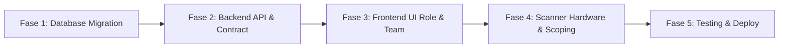

# RENCANA PENYESUAIAN BASE CODE & GAP ANALYSIS (FITUR 2.0)
## dvflow: Rencana Implementasi Bertahap, Analisis File Terdampak, dan Jaminan Tanpa Gangguan

Dokumen Versi: 2.0  
Status: Rencana Kerja Siap Eksekusi  
Prinsip Utama: **Zero-downtime, non-breaking, menjaga 375 automated tests tetap hijau.**

---

## 1. Analisis Kesenjangan (*Gap Analysis*)

| Area / Fitur | Kondisi Base Code Saat Ini (v1.0) | Kebutuhan Fitur 2.0 | Penyesuaian yang Dibutuhkan |
|---|---|---|---|
| **Role & Penyebutan** | Dipatok 3 role: `master_admin`, `admin`, `staff`. | 6 role baru: `Developer`, `Owner`, `Manajer`, `Admin`, `Pimpro`, `Member`. | Hapus constraint lama; buat tabel `app_roles`; migrasikan akun lama ke role baru yang setara. |
| **Hak Akses Fitur** | Statis di kode `canAccessPath()`. | Dinamis via checklist checklist di dashboard Master Admin. | Tabel `app_permissions` & `app_role_permissions`; endpoint CRUD roles; middleware `requirePermission()`. |
| **Sidebar Menu** | Menu tanpa izin ditampilkan abu-abu (*disabled*). | Menu tanpa izin disembunyikan sepenuhnya (*hidden*). | Perbarui `Sidebar.tsx` untuk memfilter item berdasarkan array izin dan menyembunyikan section kosong. |
| **Cakupan Produk** | Semua user melihat seluruh produk di tabel `orders`. | Pimpro & Member dapat dibatasi hanya ke produk tertentu. | Kolom `has_all_product_access` di `users` dan tabel `user_product_access`; penyesuaian query SQL `orders` & `presensi`. |
| **Scanner QR Lapangan** | Stream kamera tunggal default `environment` / laptop. | Mendukung pemilih kamera USB dan Barcode Gun (HID). | Dropdown `enumerateDevices()` kamera + `keydown listener` untuk input scanner gun keyboard wedge. |

---

## 2. Pemetaan File yang Terdampak

Berikut adalah daftar file eksisting yang akan disesuaikan dan file baru yang akan dibuat ketika tahap coding dieksekusi:

### A. Database (Supabase / PostgreSQL)
1. **File Baru**: `supabase/migrations/0024_dynamic_roles_and_product_access.sql`:
   - Membuat tabel: `app_roles`, `app_permissions`, `app_role_permissions`, `user_product_access`.
   - Menambahkan kolom `has_all_product_access` pada `users`.
   - Memasukkan data awal (*seed*) 6 role standar dan kamus permission.
   - Menyesuaikan fungsi baca `dashboard_summary` dan `presensi_page` agar memfilter `product_code` untuk user yang dibatasi.

### B. Shared Package (`packages/shared`)
1. **File Modifikasi**: [`packages/shared/src/types.ts`](file:///c:/Users/MyBook%20Z%20Series/dvflow/packages/shared/src/types.ts):
   - Memperluas definisi tipe `AppRole` agar dinamis atau mendukung union 6 role baru: `'developer' | 'owner' | 'manajer' | 'admin' | 'pimpro' | 'member' | string`.
   - Menambahkan tipe kanonik `AppPermissionKey`.

### C. Backend API Worker (`packages/api`)
1. **File Modifikasi**: [`packages/api/src/users.ts`](file:///c:/Users/MyBook%20Z%20Series/dvflow/packages/api/src/users.ts):
   - Menambahkan field `permissions` dan `allowed_product_codes` pada objek `Profile`.
2. **File Modifikasi**: [`packages/api/src/routes.ts`](file:///c:/Users/MyBook%20Z%20Series/dvflow/packages/api/src/routes.ts):
   - Mendaftarkan route `/api/roles`, `/api/roles/:id/permissions`, dan `/api/permissions`.
3. **File Baru**: `packages/api/src/roles/handlers.ts`:
   - Implementasi logika CRUD role dan update permissions checklist.
4. **File Modifikasi**: [`packages/api/src/internal-users/handlers.ts`](file:///c:/Users/MyBook%20Z%20Series/dvflow/packages/api/src/internal-users/handlers.ts):
   - Menerima `has_all_product_access` dan `product_codes` pada endpoint tambah/edit user.
5. **File Modifikasi**: [`packages/api/src/participant/handlers.ts`](file:///c:/Users/MyBook%20Z%20Series/dvflow/packages/api/src/participant/handlers.ts):
   - Pada `checkinSeminar`: memvalidasi otorisasi produk operator sebelum mengonfirmasi kehadiran.

### D. Frontend Web App (`apps/web`)
1. **File Modifikasi**: [`apps/web/src/layout/navigation.ts`](file:///c:/Users/MyBook%20Z%20Series/dvflow/apps/web/src/layout/navigation.ts):
   - Menambahkan rute `/konfigurasi-role` di section KONFIGURASI dengan penanda permission `config.roles`.
2. **File Modifikasi**: [`apps/web/src/layout/Sidebar.tsx`](file:///c:/Users/MyBook%20Z%20Series/dvflow/apps/web/src/layout/Sidebar.tsx):
   - Mengubah logika render: menyembunyikan elemen menu yang tidak berizin dan menyembunyikan section header yang kosong.
3. **File Baru**: `apps/web/src/pages/config/RoleConfigPage.tsx`:
   - Tampilan UI tabel role, tombol tambah role, dan modal checklist permission per modul.
4. **File Modifikasi**: [`apps/web/src/pages/team/TeamPage.tsx`](file:///c:/Users/MyBook%20Z%20Series/dvflow/apps/web/src/pages/team/TeamPage.tsx):
   - Menampilkan dropdown 6 role baru.
   - Menambahkan komponen radio `Semua Produk` vs `Produk Tertentu` dengan multi-checkbox produk aktif.
5. **File Modifikasi**: [`apps/web/src/pages/scanner/ScanQrPage.tsx`](file:///c:/Users/MyBook%20Z%20Series/dvflow/apps/web/src/pages/scanner/ScanQrPage.tsx):
   - Menerapkan **Skema B (Dua Mode & Dua Tombol Terpisah)**:
     - Tab/Mode 1: `Mode Kamera (HP / Webcam)` dengan tombol `[ Nyalakan Kamera ]` dan dropdown pemilih webcam.
     - Tab/Mode 2: `Mode Scanner Stick (USB / Bluetooth)` dengan tombol `[ Aktifkan Scanner Stick ]`, animasi standby radar, dan `keydown listener` untuk input scanner gun tanpa izin kamera.
   - Menambahkan penolakan check-in jika tiket milik produk di luar izin operator.

---

## 3. Rencana Eksekusi Bertahap (Phased Roadmap)

Agar pekerjaan terstruktur, aman, dan dapat diuji pada tiap langkah:

### Fase 1: Database & Migrasi Data (PostgreSQL)
1. Buat file migrasi `0024_dynamic_roles_and_product_access.sql`.
2. Pasang tabel `app_roles`, `app_permissions`, `app_role_permissions`, `user_product_access`.
3. Migrasikan akun eksisting tanpa mengubah password atau session:
   - User role `master_admin` -> dimigrasikan menjadi `developer` dan `owner`.
   - User role `admin` -> tetap `admin`.
   - User role `staff` -> dimigrasikan menjadi `member`.
4. Uji migrasi di local database.

### Fase 2: Backend API & Otorisasi
1. Sesuaikan tipe `packages/shared/src/types.ts`.
2. Buat endpoint CRUD Role dan Permission di `packages/api`.
3. Update endpoint user management untuk menyimpan data produk yang di-assign.
4. Pasang pengecekan produk di SQL query order, presensi, dan checkin.
5. Jalankan unit test API.

### Fase 3: Frontend Role Configuration & Team Management
1. Buat halaman `/konfigurasi-role` dengan tabel dan modal checklist permission.
2. Perbarui modal Add/Edit Team di `TeamPage.tsx` dengan pilihan All Produk vs Scoped Produk.
3. Perbarui `Sidebar.tsx` agar menyembunyikan menu yang tidak berizin dan membersihkan kategori kosong.

### Fase 4: Scanner Hardware Dual-Mode (Skema B)
1. Perbarui antarmuka `ScanQrPage.tsx` dengan tab pemilih mode: `[ Mode Kamera ]` dan `[ Mode Scanner Stick ]`.
2. Pada Mode Kamera: pasang dropdown pemilihan kamera eksternal (`enumerateDevices`).
3. Pada Mode Scanner Stick: matikan kamera video, pasang visual standby radar, dan aktifkan global `keydown listener` untuk menangkap tembakan laser scanner stick (HID keyboard wedge).
4. Berikan audio feedback *beep* dan visual alert kartu saat scan berhasil.
5. Tambahkan validasi penolakan check-in jika tiket peserta berasal dari produk di luar wewenang operator.

### Fase 5: Pengujian Menyeluruh & Deployment
1. Jalankan `npm run typecheck` di seluruh workspace.
2. Jalankan seluruh test suite (`npm test`).
3. Jalankan `npm run build` dan verifikasi bundle.
4. Commit, push, dan deploy ke GitHub & Cloudflare Pages.

